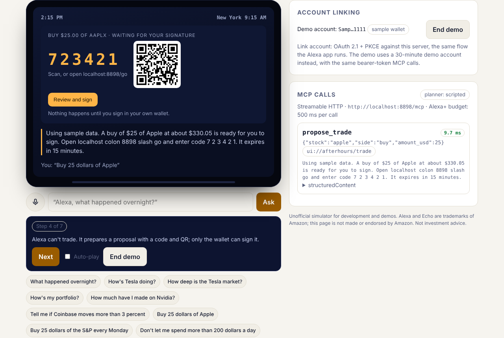

# Afterhours

**Your tokenized stocks, by voice, at any hour.** An Alexa+ add-on, built as a self-hosted MCP server.

The US stock market is open about 33 hours a week. Tokenized stocks (xStocks on Solana) trade all 168. So the moment
most people actually have time to think about their money (Saturday morning, 11pm on a weeknight) is exactly when
nobody can tell them what's going on. Afterhours closes that gap with Alexa:

> **"Alexa, what happened overnight?"**
> "The US stock market is closed for the weekend. It opens Monday at 9:30 a.m. Eastern. Biggest moves since Friday's
> close: Coinbase up 3.9 percent, Strategy up 3.0 percent and Tesla up 2.1 percent. Your Coinbase alert at 3 percent
> has triggered."

> **"Is the Tesla token trading rich?"**
> "Tesla's token is up 2.1 percent since Friday's close, at $370.56. With the share market shut, that's a bet on the
> open Monday, not a hedge."

> **"Buy 25 dollars of Apple."**
> "A buy of $25 of Apple at about $330.05 is ready for you to sign. Open afterhours dot app slash go and enter code
> 6 2 2 4 3 5. It expires in 15 minutes."


**No wallet? Try the guided demo.** Open `/sim/` and press **Try the guided demo**. Eight real turns play in about 90
seconds through the same planner and MCP endpoint: the overnight brief, a gap read as a bet on the open, a token too
thin to price ("I'd leave it alone until there's a market"), what the issuer can do on chain, a $25 buy prepared for
signing (code, QR, `ui://` card), then a guardrail set *around the current time* that holds the next buy, and won't
come off for 24 hours.



**Voice proposes, wallet disposes.** Alexa can *propose* a trade, but it can never execute one. Afterhours holds no
keys. A trade only happens when you open the confirm page, see a fresh quote, and sign it in your own wallet. A misheard
"fifty", or a TV talking in the background, can't move money.

## What's in the box

| | |
| --- | --- |
| **MCP server** | `POST /mcp`: Streamable HTTP, MCP **2025-11-25**, stateless, JSON responses. 35 tools, each with an `outputSchema` and truthful `readOnlyHint` / `destructiveHint` annotations. |
| **Account linking** | OAuth 2.1 authorization code + **PKCE (S256)**. RFC 9728 protected-resource metadata, RFC 8414 server metadata, `resource` bound to the MCP URI, rotating refresh tokens, and a bare `401` for unauthenticated MCP calls, all as Alexa+'s MCP onboarding asks. You link a **Solana wallet by signing a message** (free, can't move funds), or link a watch-only address. |
| **68 stocks and funds** | Tesla to Coca-Cola, the S&P 500 to gold. Every mint is verified before it ships (exact registry symbol, Backed's `Xs` prefix, Token-2022 owner, matching decimals, exactly one candidate) by `scripts/discover-universe.ts` in CI. Each name answers to the ways it's said ("coke", "J P Morgan", "the Russell"). |
| **Live data** | Token and share prices from Jupiter (one keyless call returns both legs), balances from Solana mainnet RPC. Prices are served from a stale-while-revalidate cache, so tool calls stay well inside Alexa+'s **500 ms** budget. |
| **Trade confirm page** | `/go`: enter the code, get a fresh Jupiter quote, sign in any Wallet Standard wallet (Phantom, Solflare, Backpack, and others). Afterhours only reports a trade as confirmed once Solana shows it succeeded **and the linked wallet paid for it**. Status flows back to Alexa ("did my trade go through?"). |
| **Solana Actions** | Every proposal is also a [Solana Action](https://solana.com/docs/advanced/actions) (`/actions.json`, `/api/actions/trade/:code`): a blink client like Phantom or Backpack, or a phone wallet scanning the Solana Pay QR code on the confirm page, can fetch and sign it directly. The transaction is built only for the proposal's wallet, and a trade signed this way is found on chain (fee payer plus the blockhash we built it against) and confirmed by the 5-minute sampler, with a push to your phone. |
| **Overnight tape** | The board is sampled every 5 minutes into a rolling 48-hour tape, and every account's alerts are checked on each sample. Briefings say *when* an alert went off ("went off at 2:14 a.m. Eastern, when it was up 2.3 percent"), and `check_stock` tells the night's story ("since Friday's close it peaked at up 5.6 percent on Saturday around 10:30 a.m., and has faded since"). |
| **Impulse guard** | Rules you set for your 2 a.m. self. A **daily spending limit** ("don't let me spend more than 200 dollars a day") applies at once when set or lowered; raising or removing it waits **24 hours**, the way self-exclusion tools work. **Sleep mode** sets any trade asked for between 11 p.m. and 7 a.m. (your time) aside: it becomes signable at wake-up and is pushed to your phone as "Slept on it? Your Tesla buy is ready." |
| **Recurring buys, no custody** | "Buy 25 dollars of the S&P every Monday." Dollar-cost averaging without handing over money or keys: each run prepares a proposal at the current price and pushes it to your phone; one tap opens it in Phantom or Solflare (or as a Solana Action) and your wallet signs it, or it lapses. Runs respect your daily limit, and "how's my S&P plan going?" tells you how many you've signed. |
| **Cost basis from the chain** | "How much have I made on Nvidia?" Wallets don't keep cost basis, so Afterhours rebuilds it from the wallet's own Solana history: every transaction where an xStock balance moved against USDC is a buy or sale at a real price, accounted at average cost, with realized gains. Tokens that arrived without a USDC payment are counted as held but left out of the average, and the answer says so. Indexed incrementally in the background. |
| **Trade history for tax time** | One tap in the companion app downloads every buy, sale and transfer the chain shows for your wallet as CSV: USDC paid or received, price per token, each sale's gain at average cost (the method is named, since many countries need FIFO), and a Solscan link per row so anyone can check it. |
| **Liquidity, out loud** | "How deep is the Tesla market right now?" Real Jupiter quotes at $100, $1,000 and $10,000 say what each size would cost over the token's price, and how much fits under 1 percent. A large proposal on a thin weekend pool gets a warning before it's signed ("At this size you'd pay about 1.3 percent over the token's price"). |
| **Weekly recap** | "How was my week?" Holdings over seven days from a daily price snapshot, who led and who lagged, recurring buys signed, alerts that went off. Pushed Sunday at 6 p.m. local time if you ask. |
| **The open, scored** | All night the token makes a call; at 9:30 the exchange answers. A few minutes in, everyone holding or watching a name that moved gets "At the open: Tesla +1.9%, Coinbase −0.4%. Tesla's token had called +2.1%; Coinbase's +3.9%. Some overnight moves held, some didn't." "How did the open go?" answers for the rest of the day. |
| **Is it Tesla, or the market?** | Each name's beta to the S&P 500 is estimated daily from a month of real share closes. Overnight, the S&P 500 token stands in for the market, so `check_stock` can say "Most of that is Tesla's own; the S&P 500 token is up 0.3 percent", or "That's mostly the market". |
| **Calendar and comparisons** | "Is the market open on Thanksgiving?" "Is Christmas Eve a half day?" "When's the next market holiday?" answered from the NYSE calendar the server already runs on. "Compare Tesla and Nvidia" puts names side by side with how strongly each moves with the market. |
| **Real dislocations, netted** | During market hours, "any tokens mispriced right now?" ranks tokens trading away from their live share by more than Jupiter's real cost to trade them at $1,000: "Coinbase, rich by 0.6 percent against about 0.2 to trade." Outside hours it says why a gap is a bet on the open, not a dislocation. |
| **Sudden-move alerts** | "Tell me if Tesla moves 2 percent within an hour." Read from the overnight tape (15 minutes to four hours back), for stocks or whole sectors, alongside ordinary move and price alerts: "Tesla's sudden-move alert went off at 2:14 a.m.: it moved up 2.3 percent within an hour." |
| **Sectors** | "How's tech doing tonight?" The 68 names in nine sectors (chips, software and cloud, internet and media, consumer, banks and payments, crypto stocks, healthcare, energy and industrials, index funds; "tech" spans the first three), each the equal-weighted average of its members' moves. Sectors can be watched by an alert like a stock: "tell me if crypto stocks move 3 percent." |
| **Watchlist** | "Add Netflix and Palantir to my watchlist." With 68 names on the board, the briefing leads with the names you follow that actually moved ("On your watchlist: Palantir up 0.8 percent and Netflix up 0.5 percent"), then the rest of the market without repeating them. Editable by voice or in the companion app. |
| **Scheduled briefing** | "Brief me every weekday at 7." Sent as a push at that time in your own time zone (your portfolio's move, watched names that moved, the biggest movers), once a day, never stale: a briefing more than 15 minutes late waits for tomorrow. Set it by voice or in the companion app. |
| **Push notifications** | Alexa only speaks when spoken to, so when an alert fires at 2 a.m. Afterhours also sends a Web Push to every device the account turned on: "Tesla went above $400". |
| **Conditional trades** | "Buy 50 dollars of Tesla if it drops below 360." The order waits, armed, until the tape sees the price cross. Then it becomes a signable proposal with a fresh code, your phone is notified, and your wallet still has the last word. |
| **Companion app** | `/app` is an installable PWA and another MCP client of the same server. It shows your portfolio, the night's moves with a chart of each, alerts you can manage, your latest trade, and the switch for notifications on that device. |
| **The night, heard** | Every overnight chart in the companion app has "Listen to the night": the gap played as pitch over three seconds (low is down, high is up), with a click each time it crosses the last close. For screen-reader users, and anyone glancing at a phone in the dark. |
| **Rebalance to a target mix** | "Keep me 60 percent S&P and 40 percent Nasdaq." Later, "how far am I from my target?" explains the drift and the trades that would fix it, paid for by the sales (no new money, drifts under 2 percent left alone). "Rebalance now" prepares them, sales first, through the same PIN, daily limit and wallet signature as any trade. |
| **Activity log** | Every change made through Afterhours (a limit raised, a PIN set or a wrong PIN tried, a trade proposed, signed or confirmed, a recurring buy prepared, a wallet alert sent) is logged with when. "What's changed on my account?" reads it back, and warns if wrong PINs were tried this week. It records what Afterhours said, never the arguments, so a PIN can't end up in it. |
| **Your data, yours** | Download everything Afterhours keeps for your account as JSON (the PIN appears only as "set"), or say "delete my data": it explains what goes, asks, needs your PIN if you set one, then removes every record, takes the account out of every schedule, and cancels anything still waiting to be signed. Nothing on Solana is touched. |
| **Spoken trade PIN** | Like Alexa's voice purchasing code: with a PIN set, no trade or recurring buy is prepared until it's said ("four seven one nine" works). Salted scrypt hash, five wrong tries lock voice trading for an hour, the PIN is never said back, and changing or removing it needs the current one. |
| **Text alerts (Amazon SNS)** | For phones without web push: verify a number with a six-digit code (hashed, five tries, three an hour) and every notice (alerts, trades ready to sign, wallet warnings, briefings) also arrives by SMS. |
| **Broken prices aren't news** | Thin token markets print nonsense: CI's live run once had the brief say "Super Micro up 17722 percent". Jupiter's own numbers showed why: $2.89 of liquidity behind that token. CI's audit of all 60 xStocks set the floor: above $100,000 of liquidity every token sat within 1% of its share, while below $10,000 (37 of the 60!) gaps ran to 727%. A token under $10,000 is now a *thin market*, and one more than 1.5× from its share a *suspect* reading. It's never ranked, averaged into a sector, sampled to the tape or alerted on, and asking about it gets "one of those prices is wrong, so I wouldn't trade on it". Trades on it are refused. |
| **Token safety, read from the mint** | "Is my Tesla token safe?" Afterhours reads the token's Token-2022 mint on Solana and says what its issuer can actually do: issue tokens, freeze holders, move or burn tokens in any wallet (permanent delegate), pause transfers, rescale balances (scaled UI amount), hooks and fees. It also says whether transfers are paused right now and whether *your* tokens are frozen, and it's honest that share backing is attested off chain. With no stock named, it checks everything you hold. |
| **Splits and dividends, ahead of time** | xStocks apply splits and dividends by changing a multiplier on the mint, so every balance changes with no transfer. Afterhours reads the scheduled change and pushes holders first: "On Wednesday, every Apple token balance gets multiplied by 1.0042: about a 0.42% dividend, paid as more tokens." Wallet watch takes the change out before comparing, so a dividend is never reported as tokens arriving. |
| **Wallet watch** | Afterhours can't move funds, so it can't protect them, but it can notice. With notifications on, the wallet's xStock balances are compared every 5 minutes; anything that left or arrived without a trade Afterhours prepared and saw confirmed is pushed at once: "4.25 TSLAx left your wallet. About $1,575. If it wasn't you, move what's left to a wallet only you control." |
| **`.sol` names** | Link a watch-only account as `toly.sol` instead of a 44-character address; names resolve through the Solana Name Service and are checked to be a real key. |
| **Measured understanding** | `eval/` holds 180 things people say, each with the tool and arguments a planner should pick, scored by meaning ("the S&P" = SPY, "7:00 am" = "7"). The scripted fallback planner scores 100% on the 148 cases it was tuned on and **50% on 32 held-out ones it never saw**, which is exactly why the real planner is Claude on Bedrock; CI gates the first, reports the second, and runs both against Bedrock when an AWS role is configured. |
| **Accessible** | The confirm page, companion app and simulator pass an axe-core WCAG 2 A/AA audit in light and dark themes, in CI on every push. |
| **Track record** | Is the overnight move worth anything? For every market open in the last month, Afterhours compares where the token traded at 9 a.m. with where the share actually opened, from public on-chain (GeckoTerminal) and exchange (Yahoo) history, refreshed daily. "Its token has called the open's direction 16 of the last 20 times." |
| **Your time zone** | "I'm in Lagos." Every time Afterhours speaks or sends is then local: "It opens tomorrow at 2:30 p.m. Lagos time." Most holders of tokenized US stocks don't live in New York. |
| **Cards for screens** | The brief, stock, portfolio and trade tools declare **MCP Apps** `ui://` cards, so hosts with a screen (Echo Show, Fire TV, any MCP Apps client) show a visual card next to the spoken answer. These are dependency-free HTML views that follow the host's theme; the trade card has the code, a QR and a "Review and sign" link. |
| **Alexa+ simulator** | `/sim/`: Alexa+'s MCP client is partner-gated, so this page plays its part. It runs the real OAuth flow, then voice in, voice out, with a live trace of every MCP call and its latency. The planner is **Claude on Amazon Bedrock** when AWS credentials are present, otherwise a deterministic intent matcher. |
| **Conformance check** | `npm run conformance -- <url>` checks a deployment against the Alexa+ requirements and measures p50/p95 latency over the network. |
| **Load tested** | `npm run load`: a realistic nighttime mix of MCP calls from up to 100 listeners at once. One Node process on one core serves **~570 requests/s with zero failures, p99 85 ms at 20 listeners and 331 ms at 100**. Profiling took it from 95 to 572 requests/s; [docs/PERFORMANCE.md](docs/PERFORMANCE.md) has the numbers, the profiles and how to reproduce them. |

### Tools

| Tool | Ask it | Annotations |
| --- | --- | --- |
| `market_status` | "Is the market open?" | read-only |
| `overnight_brief` | "What happened overnight?", "Anything I should know?" | read-only |
| `check_stock` | "How's Tesla doing?", "Is the Nvidia token trading rich?" | read-only |
| `my_portfolio` | "How's my portfolio?" | read-only |
| `set_alert` | "Tell me if Coinbase moves more than 3 percent", "Tell me if Nvidia goes above 250" | write, idempotent |
| `list_alerts` | "What alerts do I have?" | read-only |
| `remove_alert` | "Stop my Tesla alert" | **destructive**, idempotent |
| `propose_trade` | "Buy 25 dollars of Apple", "Buy 50 dollars of Tesla if it drops below 360" | write, *not* destructive: proposes only, never executes |
| `cancel_trade` | "Cancel my order" | **destructive**, idempotent |
| `trade_status` | "Did my trade go through?" | read-only |
| `token_safety` | "Is my Tesla token safe?", "Can they freeze my tokens?", "Any splits or dividends coming?" | read-only |
| `open_track_record` | "Does the weekend move usually hold for Tesla?" | read-only |
| `set_timezone` | "I'm in Lagos", "Use London time" | write, idempotent |
| `explain` | "What's a tokenized stock?", "Why is the token different from the stock?", "Is this safe?" | read-only |

Every result's text is written for the ear: it leads with the answer, rounds to what a listener can hold, and says
"percent" rather than "bps". Every gap is labelled with the session it was taken in. A 2% gap on a Tuesday afternoon is
a live, hedgeable dislocation, while the same 2% on a Sunday is a bet on Monday's open, and Afterhours says so.

## Run it

```bash
npm install
AFTERHOURS_DATA=sample npm run dev     # offline: sample board + sample portfolio
# open http://localhost:8787/sim/ → Link account → "Use the sample portfolio" → ask away
```

Live data path with no network (fake Jupiter + Solana RPC, any wallet "holds" a small portfolio):

```bash
npx tsx scripts/fake-upstreams.ts 9900 &
JUPITER_ENDPOINT=http://localhost:9900 SOLANA_RPC_URL=http://localhost:9900 npm run dev
```

With live mainnet data:

```bash
cp .env.example .env    # set AUTH_SECRET at minimum
npm run dev
```

Tests (159, no network needed): `npm test`. They cover the OAuth flow, every tool, the MCP Apps cards, the overnight tape, the live Jupiter/Solana path against faithful fakes, the on-chain payer check, the Bedrock planner loop (against a scripted stand-in for Claude), one contract suite for the memory, Redis and DynamoDB stores, the security fixes, and a compile check of every inline script. CI also runs the server against live mainnet data, lints the AWS template and builds the Docker image. Conformance against any deployment: `npm run conformance -- https://your-host`.

### Connect it to an MCP client

- **Endpoint:** `https://<host>/mcp` (Streamable HTTP)
- **Auth:** OAuth discovery from `https://<host>/.well-known/oauth-protected-resource`
- **MCP Inspector / quick testing:** `AUTH_SECRET=... PUBLIC_URL=https://<host> npm run token -- <wallet>` mints a 1-hour bearer token.
- **Alexa+:** every value the console asks for is in [docs/ALEXA.md](docs/ALEXA.md).

## Deploy

**Fastest: Render.** [](https://render.com/deploy?repo=https://github.com/ramadan904/afterhours)
The blueprint (`render.yaml`) builds the Docker image, generates `AUTH_SECRET`, runs in Virginia (close to Alexa), and
uses Render's HTTPS URL as the public URL. It's a long-running service, so the overnight tape samples on its own
timer. (Render's free plan sleeps when idle, which breaks the 500 ms budget on the first call and pauses the tape; use
Starter or above for judging.)

**AWS (App Runner + DynamoDB + EventBridge + Bedrock).** One command builds the image, pushes it to ECR and deploys
`infra/aws.yaml`:

```bash
AWS_REGION=us-east-1 ./scripts/deploy-aws.sh
```

The stack runs the server on App Runner and keeps state in DynamoDB (TTL-enabled). Signing and cron secrets are
generated in Secrets Manager. EventBridge samples the overnight tape every 5 minutes, because App Runner throttles CPU
between requests, so an in-process timer isn't reliable there. The instance role grants Claude on Amazon Bedrock for
the simulator's planner; enable model access for your chosen model in the Bedrock console first. Then follow
[docs/ALEXA.md](docs/ALEXA.md) to connect Alexa+.

**Docker anywhere.** A long-running process keeps the price cache warm.

```bash
docker build -t afterhours .
docker run -p 8080:8080 -e PUBLIC_URL=https://... -e AUTH_SECRET=... afterhours
```

**Vercel.** `vercel deploy` works as is (`api/index.ts` + `vercel.json`). Add an Upstash Redis integration so OAuth
codes, alerts, the tape and trade proposals are shared across function instances. Serverless has no timer for the
overnight tape: set `CRON_SECRET`, then add repository secrets `AFTERHOURS_URL` and `CRON_SECRET` so the included
`Overnight tape` GitHub Actions workflow calls `/api/cron/tape` every 5 minutes.

## How it fits together

```
 Alexa+ / simulator ──OAuth 2.1+PKCE──▶ /authorize ── wallet signs message ──▶ /token
        │                                                                     (JWT, aud=/mcp)
        └──Bearer──▶ /mcp  (Streamable HTTP, stateless)
                      ├─ prices ◀── cache (SWR, 10s) ◀── Jupiter price/v3 (token + share)
                      ├─ holdings ◀── Solana RPC getTokenAccountsByOwner (Token-2022)
                      ├─ alerts, proposals ◀── store (memory | Upstash)
                      └─ propose_trade ──▶ code ──▶ /go ── Jupiter quote+swap ──▶ user's wallet signs
```

- `src/market/`: universe and voice aliases, NYSE calendar and sessions, gap logic, speech phrasing, price sources and cache
- `src/mcp/tools.ts`: the 35 tools · `src/mcp/apps.ts`: MCP Apps cards
- `src/market/tape.ts`: the overnight tape · `src/market/alerts.ts`: alerts that fire with timestamps
- `src/auth/`: OAuth 2.1 server, signed tokens, wallet signature verification
- `src/chain/`: Solana balances, trade proposals, Jupiter swap client
- `src/store/`: state in memory, Upstash Redis, or DynamoDB (one contract test suite for all three)
- `infra/aws.yaml`, `scripts/deploy-aws.sh`: the AWS stack
- `src/http/`: router, pages (link, confirm, landing), simulator, trade API
- `src/sim/planner.ts`: Bedrock (Claude) and scripted planners (with follow-ups like "what about Nvidia?"), MCP client

Recording the demo? See [DEMO.md](DEMO.md) for a timed script.

## Security

Afterhours holds no keys and can't sign. See [SECURITY.md](SECURITY.md) for the threat model.

## Honest limits

- **Not tested inside real Alexa+.** Its MCP client isn't available to hackathon participants. The server follows the
  published onboarding requirements, and the simulator exercises the same OAuth and MCP paths.
- **The noise floor is an assumption.** Jupiter publishes no confidence interval, so gaps under 0.2% are reported as
  "in line". That threshold is a deliberately wide guess, not a measurement.
- **Not investment advice.** Afterhours reports prices and gaps; it does not recommend trades.

## License

MIT. See [LICENSE](LICENSE).
